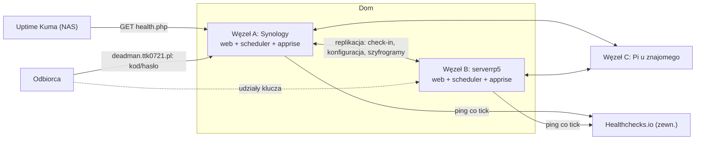
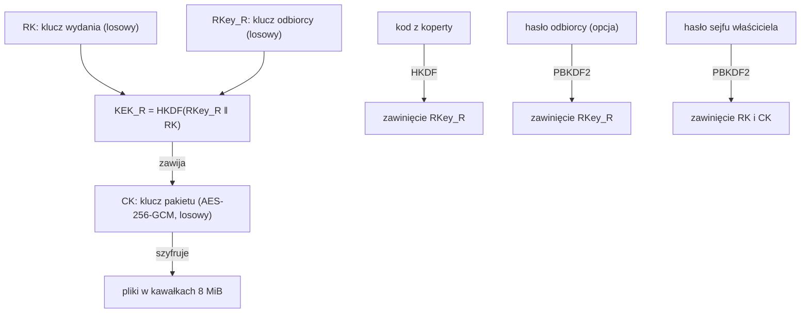

# Death Plan Switch Plus — projekt

Fork: https://github.com/ttk0721/deathplanswitch (upstream: romeo19361/deathplanswitch, MIT).
Data: 2026-11-01. Orkiestrator: AI. Szczegółowość planów: full.

## Co powiedział użytkownik

- Fork publiczny, własne dodatki, biorąc to, co dobre w innych projektach:
  - wiele kanałów powiadomień (circa10a: Discord, Telegram, ntfy…), dowolne webhooki i SMS (Dead Man's Hand),
  - szyfrowanie end-to-end (LastSignal),
  - ładny interfejs i załączniki (Aeterna).
- Publiczna strona `deadman.ttk0721.pl`. Domyślnie informuje, że switch nie jest aktywowany, i pokazuje frazy, które właściciel wpisze.
- Z tej strony po odpaleniu dostępny jest **sejf**: hasła, nagrania, zestawy folderów. Wszystko jest zaszyfrowane aż do odpalenia. Wtedy wskazane osoby dostają dane, które pozwalają odszyfrować ich zestawy.
- Instalacja na Synology NAS (Container Manager, tam stoi Uptime Kuma). NAS jest na listwie z UPS-em. Kontenery mają same wstawać po zaniku prądu, a aplikacja ma to uwzględniać.
- Redundancja: ten sam switch na NAS-ie, na Raspberry Pi w domu (`serverrp5`, Pi 5, arm64) i później na Pi u znajomego. Padnięcie jednego urządzenia nie może zatrzymać reakcji.
- Próg zgody węzłów ma być ustawialny:
  - przy 3 węzłach wybór 1 albo 2,
  - przy 2 węzłach 1,
  - bo pożar w domu zabiera oba lokalne urządzenia.
- Sekret odbiorcy ma dwie wymienne metody:
  - domyślnie kod wręczony osobiście,
  - opcjonalnie hasło ustawione przez odbiorcę.
  - Wystarczy jedna z nich.

## Założenia (moje)

- Zostaje rdzeń upstreamu: PHP 8.1+, pliki JSON zamiast bazy, eskalacja z najbliższą osobą (NOK), testy bez frameworka. Nowy kod pisany jest w tym samym stylu.
- Kryptografia sejfu działa **w przeglądarce** (WebCrypto). Serwer nigdy nie widzi treści ani kluczy w postaci jawnej.
- E-maile pozostają „wskazówkami”: gdzie szukać, kogo zawołać, link do sejfu. Sekrety trafiają do sejfu, nie do treści maila.

## Rulings

- Ruling: kryptografia tylko na WebCrypto, bez libsodium.js (bo brak zależności i CDN, a CSP zostaje `self`).
  - Hasła: PBKDF2-SHA256, 600 000 iteracji.
  - Kod z koperty (≥128 bitów entropii): HKDF.
  - Koszt pomyłki: słabsze od Argon2id dla krótkich haseł, więc UI wymusza hasło ≥ 12 znaków.
- Ruling: szyfrowanie maili OpenPGP pominięte (YAGNI). Sejf daje E2E dla tego, co tajne.
- Ruling: SMS przez dostawców obsługiwanych przez Apprise. Konkretny dostawca jest wybierany w fazie 2 po weryfikacji listy.
- Ruling: obraz Dockera budowany na amd64 i arm64, bo model Synology nie jest znany, a Pi to arm64.
- Ruling: harmonogram eskalacji upstreamu bez zmian (maks. 13 dni). Nie było prośby o zmianę.

## Architektura docelowa

## Fazy

| Faza | Zakres | Zależy od |
|---|---|---|
| 1 | Docker (amd64/arm64), scheduler w kontenerze, heartbeat do Healthchecks, healthchecki Dockera, tryb Docker w instalatorze, CI, instrukcja Synology | — |
| 2 | Kanały powiadomień: Apprise (Discord, Telegram, ntfy, SMS…), generyczny webhook z HMAC, kanały właściciela i kontaktów | 1 |
| 3 | Sejf: pakiety plików i notatek szyfrowane w przeglądarce, załączniki (nagrania), dwie metody sekretu odbiorcy, publiczna strona startowa | 1 |
| 4 | Federacja: 2–3 węzły, replikacja, próg K z N (Shamir), wydawanie udziałów po odpaleniu | 3 |
| 5 | Nowy wygląd panelu i strony publicznej | 3 |

Każda faza ma osobny plan wykonawczy w `docs/plans/`. Ten dokument jest specyfikacją całości.

### Faza 1 — Docker i odporność

- **Obraz** `php:8.4-apache`. Dane w wolumenie `/data` (zmienna `DPS_DATA`), poza katalogiem WWW. Probe zwraca wtedy `outside`, czyli folder danych jest nieosiągalny z sieci.
- **Dwie usługi z tego samego obrazu:**
  - `web` (Apache),
  - `scheduler`: pętla PHP co 15 minut, każdy tick w osobnym procesie, uruchamiana jako `www-data`.
- **Restart:** `restart: unless-stopped` i `init: true`.
- **Zanik prądu:**
  - Silnik liczy wszystko od zapisanych znaczników czasu, więc po powrocie nie ma fałszywego alarmu. Zaległe kroki idą co najmniej 12 h od siebie.
  - Zapisy są atomowe, z kopią `.bak`.
  - Do tego ustawienia DSM: automatyczne włączenie po powrocie zasilania i bezpieczne wyłączenie przez UPS.
- **Heartbeat:** po każdym ticku GET na `HEARTBEAT_URL`. Gdy tick się nie udał albo `health()` zgłasza problem, GET na `HEARTBEAT_URL/fail` z listą problemów. Zewnętrzny Healthchecks.io alarmuje, gdy pingi ustaną, także gdy padnie cały NAS.
- **Healthcheck Dockera:**
  - `scheduler` jest „unhealthy”, gdy ostatni tick był ponad 40 minut temu,
  - `web` odpowiada na HTTP.
- **Instalator i Ustawienia** w trybie Docker nie pokazują linii crontaba. Opisują kontener schedulera i czekają na jego pierwszy przebieg.
- **Reverse proxy:** `mod_remoteip` dla prywatnych zakresów, więc blokada logowania liczy prawdziwe IP. `X-Forwarded-Proto` jest już obsługiwane.
- **CI** (GitHub Actions): testy na PHP 8.1 i 8.4, a po wejściu na `main` budowa multi-arch i publikacja w `ghcr.io/ttk0721/deathplanswitch`.
- **Instrukcja** `docs/pl/synology.md` opisuje:
  - projekt w Container Manager, auto-restart, ustawienia zasilania i UPS,
  - Kumę na `health.php`, Healthchecks.io,
  - publikację pod `deadman.ttk0721.pl` (Cloudflare Tunnel albo reverse proxy DSM z HTTPS),
  - kopię `/data` przez Hyper Backup.

### Faza 2 — Kanały powiadomień

- **Sidecar** `caronc/apprise` (apprise-api) w compose. Aplikacja woła `POST http://apprise:8000/notify/` z listą URL-i Apprise (`discord://…`, `tgram://…`, `ntfy://…`, SMS).
- **Generyczny webhook:** `POST` JSON z podpisem `X-DPS-Signature: sha256=HMAC(body)`, dla własnych integracji.
- **Kanały:** każdy kontakt i właściciel mają listę kanałów (Apprise URL albo webhook). Wiadomość kanałowa jest krótka (temat, link), a pełna treść zostaje w mailu.
- **Semantyka:** krok eskalacji jest dostarczony, gdy przyjął go e-mail **albo** co najmniej jeden kanał. Błędy kanałów trafiają do historii i `health()`.
- **Prywatność:** kanały grupowe (np. kanał Discorda) widzą wszyscy jego członkowie i operator usługi. UI ostrzega przy dodawaniu kanału.

### Faza 3 — Sejf i strona publiczna

Model kluczy. Wszystkie operacje kryptograficzne wykonuje przeglądarka:

- Do otwarcia potrzeba **jednocześnie** sekretu odbiorcy (kod **albo** hasło) i klucza wydania RK. RK jest wydawany dopiero po odpaleniu switcha. Sam serwer nie odszyfruje niczego, a sam odbiorca przed czasem też nie.
- **Pakiet** to zestaw plików lub notatek przypisany do jednego albo kilku odbiorców. Pliki są szyfrowane w kawałkach (nonce = losowy prefiks + numer kawałka, numer i ID pliku w AAD). Upload też idzie w kawałkach, więc obsłuży duże nagrania.
- **Kod z koperty:** 24 słowa (polska lista słów, wbudowana) i QR do wydruku. Pokazywany raz.
- **Hasło odbiorcy:** odbiorca otwiera zaproszenie, wpisuje kod z koperty i ustawia hasło. Przeglądarka dodaje drugie zawinięcie RKey_R. Kod dalej działa.
- **Strona publiczna** `/`:
  - przed odpaleniem: „Switch nie jest aktywowany” oraz frazy właściciela (edytowalne w Ustawieniach),
  - po odpaleniu: formularz „Otwórz sejf” (kod albo hasło), lista pakietów odbiorcy i pobieranie z odszyfrowaniem w przeglądarce.
  - Panel właściciela przechodzi pod `panel.php`.
- **Faza 3 bez federacji:** RK jest trzymany przez jedyny węzeł (K=1, N=1) i wydawany po `fired`.

### Faza 4 — Federacja węzłów

- **Węzły i klucze:** każdy węzeł ma parę kluczy Ed25519 (`sodium`, wbudowane w PHP). Lista węzłów (URL, klucz publiczny, priorytet) i próg K są w konfiguracji. Komunikacja jest podpisana, przez HTTPS albo Tailscale.
- **Węzeł główny** (NAS) służy do edycji. Konfiguracja, kontakty i szyfrogramy sejfu są replikowane na pozostałe węzły. Szyfrogramy są bezpieczne do kopiowania.
- **Check-in** przyjęty na dowolnym węźle jest rozgłaszany do wszystkich. Zapamiętywany jest najnowszy znany check-in.
- **Brak duplikatów:** krok eskalacji wykonuje pierwszy żywy węzeł w kolejności priorytetu. Węzeł o randze r czeka r × 30 minut i sprawdza, czy wyższy węzeł zgłosił wykonanie kroku.
- **Ochrona przed fałszywym odpaleniem przy rozspójnieniu:** węzeł, który nie słyszy żadnego peera, zanim sam wyśle krok do NOK lub kontaktów, dolicza karę izolacji (+48 h na krok) i ponawia próbę kontaktu z peerami.
- **Udziały klucza:** RK jest dzielony Shamirem K z N (GF(256)), po jednym udziale na węzeł. Węzeł wydaje swój udział tylko w stanie `fired`. Przeglądarka odbiorcy zbiera udziały z adresów węzłów (CORS) i składa RK.
  - K=1: każdy węzeł ma pełny klucz.
  - K=2 z 3: przejęcie jednego węzła (np. u znajomego) nic nie daje.
- **Zmiana progu lub liczby węzłów:** właściciel generuje nowe RK w przeglądarce (hasłem sejfu) i rozsyła nowe udziały.

### Faza 5 — Wygląd

- Spójny system kolorów, tryb ciemny i nowe komponenty (karty pakietów, osie czasu eskalacji).
- Strona publiczna w stylu „karta statusu”.
- Bez zewnętrznych CDN, bo CSP musi pozostać `self`.

## Obsługa błędów (przekrojowo)

- Żaden kanał ani węzeł nie może zablokować eskalacji e-mailowej. Każdy dodatek jest addytywny.
- Każda nowa zależność zewnętrzna (Apprise, peery, Healthchecks) zgłasza swój stan do `health()`, a więc do Kumy i heartbeat.
- Uszkodzenie danych sejfu nie wpływa na switch. Szyfrogram ma sumy GCM, a uszkodzony kawałek pokazuje się jako błąd pobierania.

## Testy

- PHP: istniejący `tests/run.php` oraz nowe pliki `tests/*_test.php` uruchamiane w kontenerze `php:8.4-cli`.
- JS (kryptografia sejfu, Shamir): testy w Node (`node:22`, wbudowane WebCrypto) na wektorach testowych.
- Każda faza kończy się próbą generalną `tests/timeshift.php` na kontenerach.
